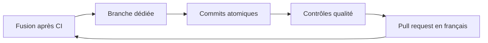

# Contribuer à Faluss Platform

## Principe

Chaque changement est développé dans une branche dédiée et livré dans une pull request petite et cohérente. La branche `main` reste protégée et publiable.

Ces règles s'appliquent aux contributions humaines et à celles produites avec une IA. Un commit direct, une fusion locale ou un contournement administrateur vers `main` est interdit, même si la CI passe ensuite. La relecture humaine reste possible, sans être une condition de fusion.



## Issues et métadonnées

Avant toute modification, y compris documentaire ou automatisée, identifier la
forge depuis le remote. Les lectures nécessaires à ce diagnostic sont permises.
Le dépôt actuel est `Alternative-LAB/faluss-platform` sur **GitHub** ; la procédure
GitLab ci-dessous s'applique uniquement lorsqu'un remote GitLab est configuré.
Ne pas créer une issue sur une autre forge et ne pas migrer le dépôt implicitement.

1. Rechercher les issues ouvertes **et fermées** par symptôme, module et objectif,
   puis lire les candidates. Parcourir les pages ; une première page vide ne suffit
   pas. Réutiliser une issue ouverte correspondant au même périmètre. Une issue
   fermée renseigne une régression, mais ne remplace pas une nouvelle issue liée.
2. Vérifier aussi les branches et PR/MR en cours. Relancer une recherche juste
   avant création pour limiter les doublons ; un seul coordinateur écrit les
   métadonnées. Les automatisations de release sont sérialisées.
3. Sans correspondance, créer automatiquement une issue courte en français depuis
   [ISSUE_TEMPLATE.md](ISSUE_TEMPLATE.md), seul template de contenu. Conserver
   Contexte, Objectif, Travail attendu et Critères d'acceptation. Informations
   complémentaires est facultatif. Remplir les sections, supprimer les consignes.
4. Lire les labels du projet et ceux hérités du groupe sur GitLab. Appliquer les
   conventions existantes de **type, priorité et statut** ; un seul label par axe
   exclusif, sauf convention contraire. Remplacer le statut au fil du travail,
   conserver type et priorité ; ne pas changer une priorité sans justification.
5. Au relevé du 13 octobre 2026, GitHub fournit notamment `bug`, `enhancement` et
   `documentation`, sans label de statut ou priorité. Utiliser le type pertinent
   et consigner les axes manquants dans Informations complémentaires. Le statut
   suit alors l'issue et la PR, et la priorité est explicitée selon l'impact.
   Ne pas créer de labels arbitraires ni prétendre respecter une convention absente.
6. Reporter le lien de l'issue dans la PR/MR (`Closes #N` lorsque la cible clôture
   effectivement l'issue). Une PR dépendante ne clôture pas prématurément l'issue.

Une erreur d'accès ne signifie jamais « aucune issue ». Corriger l'accès ou
signaler le blocage avant d'écrire dans le dépôt ; conserver les résultats utiles.
Ne jamais placer de token dans un fichier versionné ou dans un message.

Le workflow `prepare-release.yml` recherche ou crée une issue de maintenance
avant de générer les fichiers, l'identifie par un titre stable contenant le SHA
complet de `main` et lie sa PR à
cette issue. Une reprise réutilise l'issue ouverte ; les doublons ou une issue
fermée bloquent la reprise pour éviter une seconde publication. Une branche déjà poussée est réutilisée seulement si ses fichiers de version et
changelog correspondent à ceux générés ; une PR ouverte existante est réutilisée.
Le workflow ne s'exécute que sur `main`. Les titres stables sont le contrat de
recherche des releases automatiques ; les issues manuelles restent recherchées
par l'agent avant de lancer le workflow.

[WORKFLOW_LABELS.json](WORKFLOW_LABELS.json) contient les correspondances approuvées
pour cette automatisation : `null` signifie qu'aucun label n'est configuré pour
cet axe, dont la valeur reste dans l'issue. Les labels distants sont relus à chaque
exécution ; un label configuré mais absent bloque le workflow. Mettre ce mapping
à jour si les conventions changent, sans inventer de label. Le jeton
`RELEASE_PR_TOKEN` doit permettre la lecture/création d'issues en plus des PR.

### Procédure outillée

Utiliser le client authentifié ou l'API disponible. Vérifier `--help` pour la
version installée, les options de pagination et les labels avant d'exécuter.
Préparer le titre et le corps exacts dans un fichier temporaire ; ne pas passer
une description multiligne par interpolation shell.

Sur GitHub, utiliser `gh issue list --repo Alternative-LAB/faluss-platform
--state all --search <mots-clés>` puis `gh issue view` ; compléter la recherche
par l'API paginée si nécessaire. Lire `gh label list`, puis créer via
`gh issue create --title <titre-français> --body-file <fichier> --label <label>`
en précisant le dépôt. Réutiliser l'issue et la branche à la reprise.

Sur GitLab, utiliser `glab issue list` pour les états ouverts et fermés, `glab
issue view` pour les candidates et `glab label list` pour les labels. Pour une
recherche exhaustive, utiliser l'API paginée
`GET /projects/:id/issues?scope=all&state=all&search=...` et lire les labels projet
et groupe ; encoder les identifiants et paramètres. Créer via
`POST /projects/:id/issues` avec `title`, `description` et `labels` structurés,
puis vérifier l'IId et les labels retournés. Utiliser l'API ou le connecteur
exposé par l'environnement, sans installer de dépendance inutile.

## Branches

Pour toute nouvelle branche, utiliser un nom en anglais avec l'un des trois
préfixes : `feat/` (fonctionnalité), `fix/` (correction), `chore/` (documentation,
maintenance, tests, refactorisation ou CI). Inclure le numéro de l'issue :
`feat/204-module-registry`, `fix/204-duplicate-registration` ou
`chore/204-agent-workflow`. Une branche dédiée par issue ; réutiliser sa branche
si l'intervention reprend le même objectif. Les anciens noms restent historiques.

Créer la branche depuis `origin/main` après `git fetch origin`, dans un arbre
propre ou un worktree isolé. Ne pas introduire `develop` ou un nouveau Gitflow :
la base actuelle est `main` et doit rester publiable. Ne pas modifier la branche
principale locale pour contourner une PR.

Quand une petite PR dépend d’une autre PR non fusionnée, créer la branche suivante depuis la branche précédente et choisir cette dernière comme base de la nouvelle PR. Chaque PR montre ainsi uniquement son propre changement. Après fusion de la PR de base, rebaser ou ajuster la cible de la suivante vers `main`. Les contrôles CI s’exécutent sur toutes les PR, y compris celles de cette chaîne.

## Commits

Les sujets de commits utilisent un gitmoji suivi d’un message impératif en anglais :

```text
✨ Add module registry
🐛 Prevent duplicate route registration
📝 Document the module lifecycle
```

La description facultative du commit est également rédigée en anglais.

## Pull requests

Les PR sont rédigées en français avec le template du dépôt. Elles doivent :

- expliquer leur objectif ;
- décrire les changements ;
- contenir un changelog clair ;
- lister les vérifications réellement effectuées ;
- évaluer l’intégration avec les deux sites et les modules existants ;
- indiquer les risques et la procédure de retour arrière ;
- inclure des captures pour toute modification visuelle.

Une ligne correspondante doit aussi être ajoutée sous `Unreleased` dans `CHANGELOG.md`.

## Protection GitHub de `main`

Le workflow « PR governance » lit les règles depuis la branche de base avec
`pull_request_target` et traite le code proposé uniquement comme des données.
Une PR qui modifie le workflow ne peut donc pas affaiblir son propre contrôle.
Ce workflow vérifie le préfixe et le numéro d’issue de la branche, la référence
à une issue ouverte dans la PR et la forme de la contribution ; il ne peut pas empêcher à lui
seul un push direct. La protection GitHub est le verrou effectif.

Vérification distante du 13 octobre 2026 : la protection classique exige
`Check JavaScript syntax`, `Lint, static analysis and tests` et
`Federation without native Sodium`, avec branche à jour et application aux
administrateurs. Le ruleset impose une PR et interdit suppression/push forcé.
Les autres contrôles listés ci-dessous ne sont pas encore tous imposés par la
configuration distante. Les règles du dépôt exigent leur succès ; un
administrateur doit compléter la protection pour en faire un verrou effectif.
Cette modification documentaire ne change pas les paramètres distants.

Configurer une règle de protection ou un ruleset ciblant exactement `main` :

1. Exiger une pull request avant toute fusion, avec zéro approbation obligatoire.
   Exiger la résolution des conversations lorsqu'il y en a.
2. Exiger le statut de commit `Faluss PR governance` publié sur le dernier
   commit de la PR par GitHub Actions, ainsi que tous les contrôles applicables sur le commit à fusionner,
   notamment `Lint, static analysis and tests`, `Federation without native Sodium`,
   `Check JavaScript syntax`, `Fans editorial isolated SQL`,
   `Identity admin-post real WordPress` et `Validate WordPress archive`. Sélectionner GitHub
   Actions comme source attendue de chaque statut, jamais « n'importe quelle
   source ». Exiger une branche à jour avant fusion si la règle GitHub le permet.
3. Interdire les poussées forcées, la suppression de `main` et tout acteur de
   contournement, y compris les administrateurs, applications et jetons
   d'automatisation. Ne pas autoriser de poussée directe sur `main`.
4. Vérifier la protection après sa création avec une PR valide et un essai de
   push direct rejeté, sans modifier le contenu de `main`.

Le nom exact des contrôles doit être choisi parmi les statuts publiés par les
workflows du dépôt. Après modification de la protection, vérifier dans GitHub
qu'aucun rôle ni application ne figure dans la liste de contournement.

## Taille des changements

Une PR doit répondre à un seul objectif. Le scaffold, le registre des modules, un module métier, une migration de données et une refonte visuelle doivent être livrés séparément lorsqu’ils peuvent être relus et validés indépendamment.

## Documentation

La documentation évolue dans la même PR que le code concerné. Les diagrammes utilisent Mermaid afin de rester versionnés, lisibles et modifiables avec le code.

## GitLab et merge requests

Sur un dépôt GitLab configuré, conserver la même base, les mêmes préfixes et
commits. Rédiger titre et description de MR en français en reprenant les sections
du [template de revue existant](../.github/pull_request_template.md), sans seconde
copie. Exiger une MR, une branche protégée sans push direct ni contournement,
les discussions résolues et tous les jobs applicables réussis sur le dernier SHA.
Un pipeline absent, annulé, ignoré ou encore en cours ne vaut pas une CI verte.
Les validations bloquantes de gouvernance proviennent de la base de confiance ;
une modification de contrôle ne doit pas s'auto-valider.

La configuration GitLab CI et les protections devront être vérifiées sur cette
forge avant toute fusion : ce dépôt ne contient actuellement que GitHub Actions.
Ne pas annoncer une protection distante comme active sans l'avoir consultée.

## Vérification et clôture

Exécuter les commandes de la CI qui correspondent au changement :
`composer validate --strict`, lint PHP, `composer analyse`, `composer test`,
contrats historiques concernés, `node --check`, tests JS concernés et
`composer audit --locked`. Les recettes SQL/WordPress et la validation d'archive
restent obligatoires dans la CI lorsqu'elles s'appliquent. Pour une évolution
purement documentaire, vérifier liens locaux, cohérence des règles et
`git diff --check` ; expliquer pourquoi les tests runtime sont sans objet.
Ne pas installer un nouveau formateur simplement pour satisfaire une case.

Avant fusion, observer tous les contrôles applicables du dernier commit et
vérifier les protections effectives. Après une nouvelle poussée, une CI verte
sur un ancien SHA ne suffit pas. Conserver les garde-fous existants même pour les
fichiers de gouvernance. Le bilan donne issue, branche, fichiers modifiés,
vérifications exécutées, limites et état réel de la PR/MR. Ne fermer l'issue
qu'une fois les critères satisfaits et la livraison effective.
