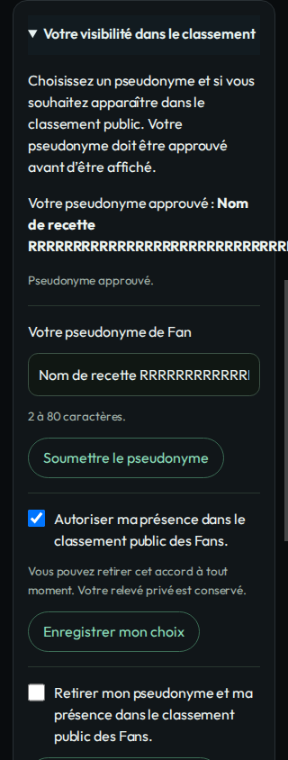
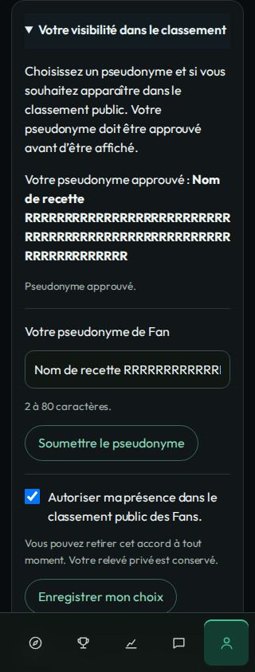

# B6 — préférences de visibilité et modération des pseudonymes

## Provenance et portée

Les rapports proviennent des véritables modules Hub/Fans sur deux WordPress
jetables : **WordPress 7.1.2, PHP 8.5.4, MariaDB 11.8.6**. Identités liées,
achats, PF, clients et clés sont fictifs. Les formulaires propriétaires et
administratifs sont lus et soumis en HTTP avec les cookies WordPress locaux.
Les consommations et corrections passent par les services/protocoles réels de
la fixture ; aucune réponse REST simulée ne remplit ces écrans.

La source immuable exécutée est l'arbre `13e9ff3c4fb1c2c1bfd718806c5ed718d383e792`,
avant actualisation de la base Me/version. Les **18 fichiers PHP/Python/CSS du
lot exécutés sont identiques** au head `1b97a9a8c9be043911d894328c0439058dd5f219` :
[empreintes LF vérifiées](tested-runtime.json). La base actualisée apporte
l'import de liens Me et la version 0.13.0, sans modifier ces fichiers Fans.
La qualité complète a également été exécutée après cette actualisation.
Les preuves CI du head final et de son intégration sur main restent distinctes
de cette recette locale ; elles sont consignées dans la PR #224.

Le navigateur Chromium 151 utilise des largeurs et le tactile **émulés**, par
connexion locale au véritable serveur WordPress jetable. Un adaptateur de
recette impose le schéma HTTPS logique aux cookies sur le loopback HTTP ; ce
n'est ni le véritable SSO Me, ni TLS, ni Elementor/thème cible, ni un appareil
physique. Aucun site, flag réel, pair de production ou paiement n'a été utilisé.

## Résultats

| Preuve | Résultat |
|---|---|
| [Recette WordPress/MariaDB complète](wordpress-checks.json) | 791 contrôles, 0 échec, dont 64 B6 ; fixture supprimée |
| Nouveaux contrôles applicatifs de préférences | 22 contrôles B6 supplémentaires par rapport à la recette #212 |
| [Navigateur](browser-checks.json) | 48 écrans de régression + 18 mesures de préférences, 0 échec |
| Largeurs contrôlées | 320, 375, 390, 430, 768 et 1440 px |
| Parcours natifs | Clavier sur ordinateur et tactile mobile : proposition, approbation, retrait d'accord et restauration explicite |
| [Qualité sur le head actualisé](quality-checks.json) | 795 tests / 7 879 assertions ; HoF 84 / 291 ; PHPStan cible 8.3.35 : 0 erreur |
| Contrôles ciblés | 13 PHP lintés, 3 Python compilés, scan de secrets et diff-check réussis ; 2 dépréciations historiques |

Nonce invalide ou d'un autre compte, faux propriétaire/famille, formulaire
admission/préférence ambigu, concurrence des révisions propriétaire/modérateur,
rejet, révocation et retrait confirmé sont vérifiés par les vrais POST. La
lecture du classement conserve le dernier nom approuvé pendant examen et ne
diffuse aucun texte pending. L'approbation ne renouvelle jamais un accord retiré.
Le relevé privé corrigé reste conservé. Une incertitude Hub ferme le score mais
n'empêche pas le retrait local. Le fuseau WordPress Europe/Paris est testé en
présentation avec vérification de l'enregistrement UTC strictement inchangé.

## Échec conservé et correction

La [recette navigateur antérieure](before-browser-checks.json) reste en échec :
le pseudonyme valide de 80 caractères sans coupure débordait après approbation
aux largeurs 768/430/390/375/320. La correction est limitée à
`overflow-wrap:anywhere` sur les préférences. Le garde n'a été ni supprimé ni
assoupli. La recette complète corrigée a ensuite été réexécutée avec succès.
Un rejeu HTML intermédiaire a servi au diagnostic visuel uniquement ; ses
résultats ne sont pas additionnés aux 66 vérifications du vrai navigateur.

| Avant, route réelle 320 px | Après, route réelle 320 px |
|---|---|
|  |  |

## Captures examinées

Les 29 captures finales ont été examinées. Les compteurs et noms visibles sont
ceux enregistrés par la fixture fictive, pas des données ajoutées au template.
Les images ne sont pas retouchées ; aucun HTML avec nonce ou cookie n'est publié.
Les vues mobiles montrent un viewport défilé jusqu'au formulaire. Les captures
ordinateur pleine page après défilement conservent l'ancrage courant des éléments
fixes/sticky ; les vues `fan-statement-*` montrent la page au repos. Aucun style
de sidebar ou shell commun n'a été modifié pour produire ces images.

| État | Ordinateur | Mobile |
|---|---|---|
| Espace Fan, préférences repliées | [1440](fan-statement-1440.png) | [390](fan-statement-390.png) |
| Saisie et focus visible | [1440](privacy-fan-edit-1440.png) | [390](privacy-fan-edit-390.png) |
| Proposition pending, ancien nom approuvé conservé | [1440](privacy-fan-pending-1440.png) | [390](privacy-fan-pending-390.png) |
| Pseudonyme long approuvé | [1440](privacy-fan-approved-1440.png) | [390](privacy-fan-approved-390.png) |
| Panel de modération | [1440](privacy-moderation-pending-1440.png) | [390](privacy-moderation-pending-390.png) |
| Consentement Créateur séparé | [1440](privacy-creator-consent-1440.png) | [390](privacy-creator-consent-390.png) |
| Progression, préférences repliées | [1440](creator-statement-1440.png) | [390](creator-statement-390.png) |
| HoF invité | [1440](visitor-hof-1440.png) | [390](visitor-hof-390.png) |
| HoF Fan | [1440](fan-hof-1440.png) | [390](fan-hof-390.png) |
| HoF Créateur | [1440](creator-hof-1440.png) | [390](creator-hof-390.png) |
| Classement Fans | [1440](fan-ranking-1440.png) | [390](fan-ranking-390.png) |
| Classement Créateurs | [1440](creator-ranking-1440.png) | [390](creator-ranking-390.png) |
| Session et règles | [1440](fan-session-1440.png) | [390](fan-session-390.png) |

[Focus clavier du classement](fan-ranking-focus-1440.png).
Les empreintes des preuves publiées sont dans [SHA256SUMS.json](SHA256SUMS.json).

## Limites conservées

Cette livraison raccorde les préférences et leur modération. Les formulaires
de sessions, participations, territoires et intentions ne sont pas déclarés
terminés. Les portraits/médias HoF ne sont pas inventés : leur contrat de
livraison manque, comme indiqué pour #212. Aucun graphe, récompense ou indicateur
financier Créateur ne remplit les espaces de la planche.

Admission/source d'achat réelles, vraie recette Me SSO/site, fraîcheur continue,
conservation #150 et stockage privé RustFS #161 restent distincts. Ces preuves
ne rendent aucun classement activable sur les sites. Aucune CI, préparation,
cache, délai, matrice, configuration de runner ou assertion historique n'a été
modifié pour obtenir les résultats.
