# Choix des sessions avant attribution — preuves fermées séparées

## Fonctionnement WordPress/MariaDB

### Intégration finale des parcours fermés

Main `cfcd7c9bb45b6ade3fc6e3d88f3745371ca99504` (#239 et #240 intégrées) :
[PHP39141732308](https://github.com/Alternative-LAB/faluss-platform/actions/runs/39141732308),
tous les contrôles réussis, artefact12141849049 téléchargé et examiné :
**973 vérifications, zéro échec**,36 casB6sc, fixture supprimée.
Rapport exact : [wordpress-integrated-ci.json](wordpress-integrated-ci.json).
Cette preuve inclut pagination après un ancien checkpoint terminal, refus de
remplacer une ancienne intention et parcours natif multi-sessions avec réponse
perdue, lookup primaire et remise d'un seul remerciement figé après rapprochement.
Elle reste une recette Hub/Fans jetable avec données et identités fictives,
distincte du véritable SSO et de la CI du futur main de publication.

### Première preuve et provenance des captures

Head testé : `480d8d487bc04b15ad777f60da1be72906b967ac`.
[PHP quality 39087392229](https://github.com/Alternative-LAB/faluss-platform/actions/runs/39087392229), tous les contrôles réussis.
Artefact `12121318401` téléchargé et examiné : **926 vérifications, zéro échec**,
WordPress 7.1.2, PHP 8.3.35, MariaDB 10.11.14-MariaDB-0ubuntu0.24.04.1.
La fixture a été supprimée. Résultats complets : [wordpress-ci.json](wordpress-ci.json).

Les cas `B6sc` couvrent les admissions natives et leurs preuves primaires,
la sélection explicite sans choix par défaut, la pagination, les identités et
nonces distincts, les formulaires HTTP natifs, les confirmations concurrentes,
les réponses perdues après commit, le lookup avec la même clé, les reprises
après suspension et l'interdiction de remplacer une intention incertaine.
Les anciens contrats et les deux ledgers restent préservés.

Cette preuve concerne uniquement des instances Hub/Fans jetables avec identités,
achats et clés fictifs. Le champ générique `not_proven` du rapport conserve sa
frontière de production ; les cas B6sc détaillent le nouveau parcours **fermé**,
sans attester un SSO central, une source d'achat ou un accès de production.

La correction suivante `eb73cbf7d673b435fefc2f44e64db24b0e67230b` conserve les cases cochées lors
de la pagination d'un nouveau formulaire après un ancien checkpoint terminal,
et refuse un ancien formulaire déjà remplacé. Ces régressions passent dans la
preuve intégrée973/0 ci-dessus ; la preuve926/0 est conservée comme historique
de construction et ne lui est pas substituée.

## Rendu navigateur sous Windows

Les captures utilisent les classes de vues exactes du commit
`eb73cbf7d673b435fefc2f44e64db24b0e67230b`, PHP 8.4.24 et Chrome headless sous Windows.
Les modèles de lecture sont explicitement fictifs. **Ce ne sont pas des pages
WordPress actives, une soumission navigateur ou une recette du véritable SSO.**
Le fonctionnement serveur est prouvé séparément par la recette ci-dessus.

[browser-replay.json](browser-replay.json) : quinze captures aux largeurs
1 440, 390 et 320 px, police Outfit, six accès Fan, absence de débordement et
d'UUID visible, focus clavier. Les cases natives ont été cochées puis décochées
au clavier et au toucher, sans soumettre le formulaire. Le serveur et Chrome
temporaires ont été arrêtés. Captures examinées par l'agent avant revue.

Les états couverts sont : choix disponibles, détail après défilement, aucune
session admissible, résultat incertain et soutien confirmé. L'absence de session
n'empêche pas un soutien sans rattachement de session ; aucune sélection ni
consommation n'est générée lors d'une lecture.

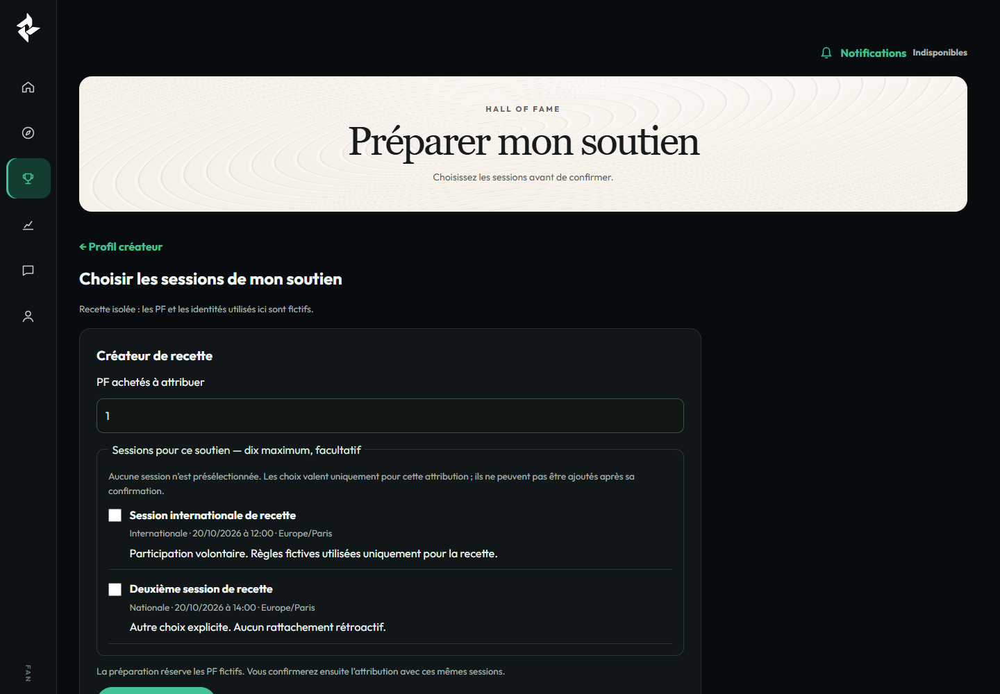

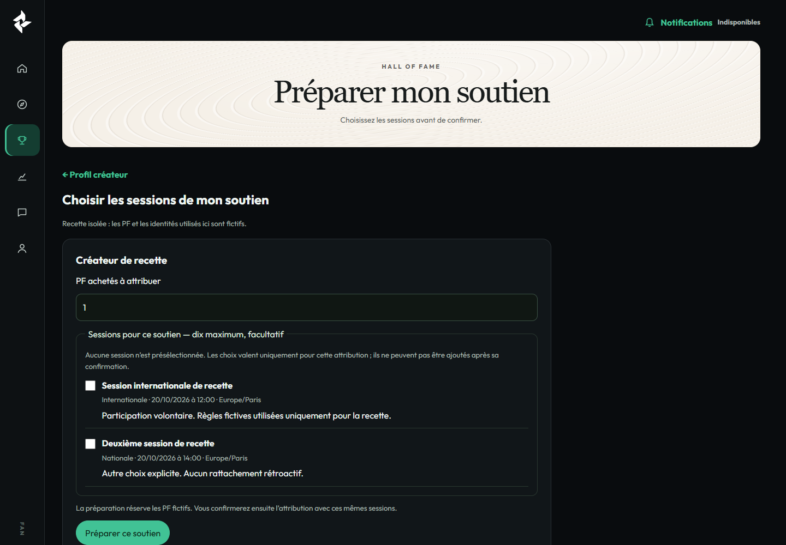

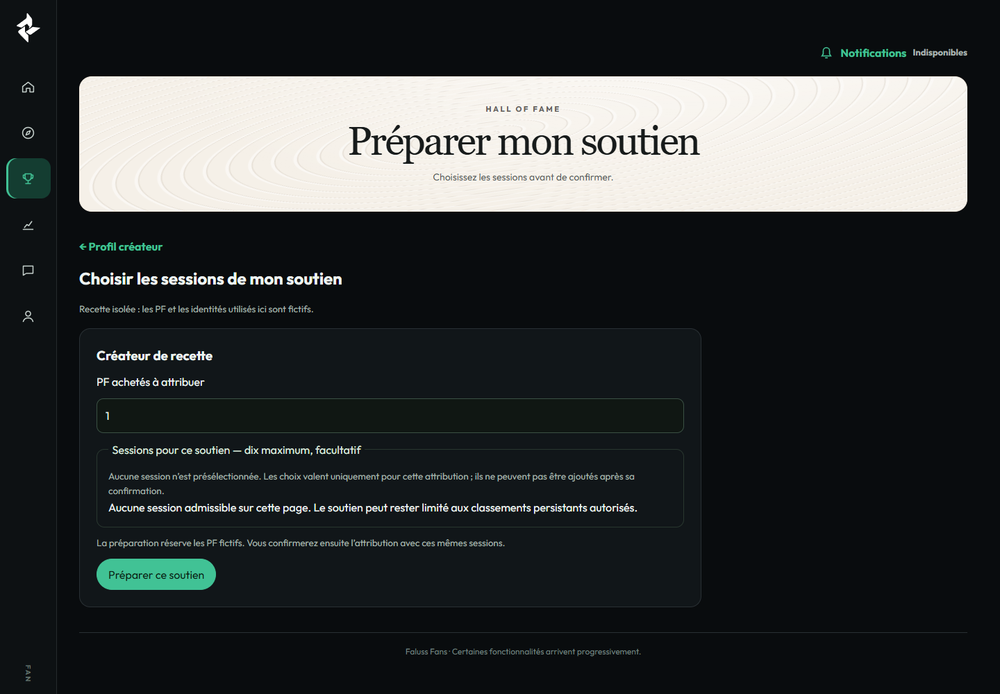

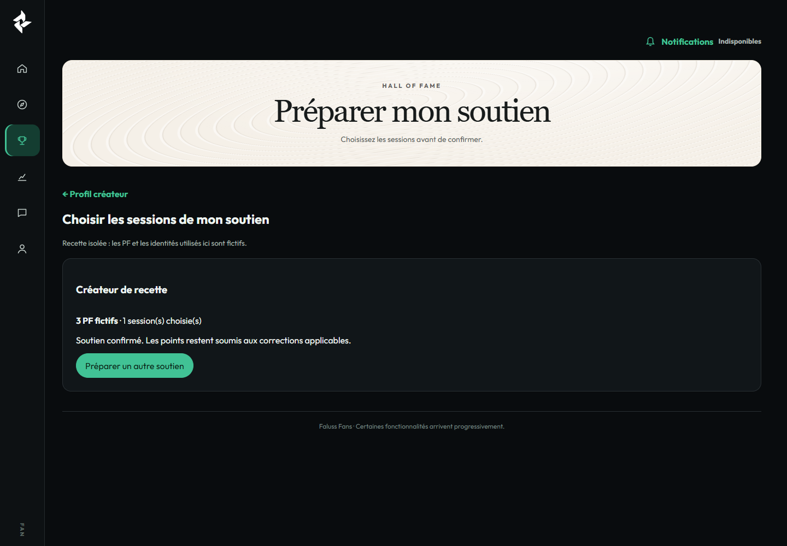

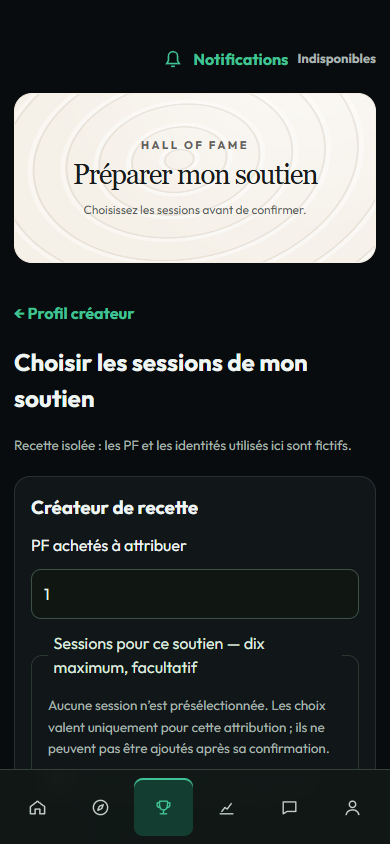

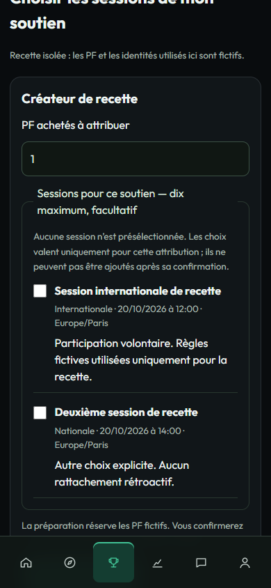

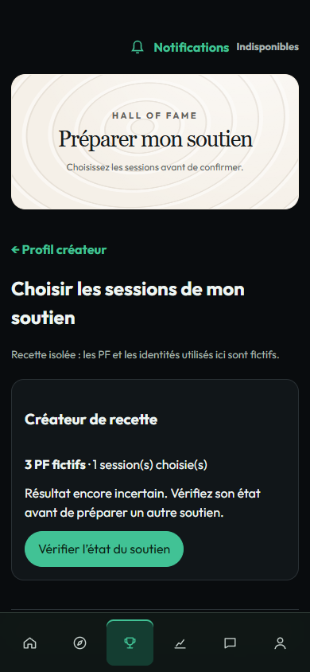

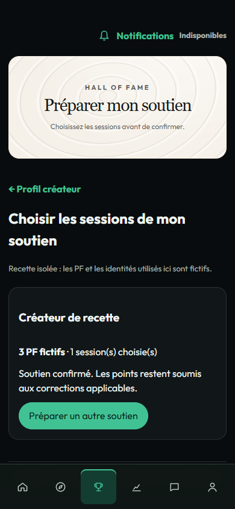

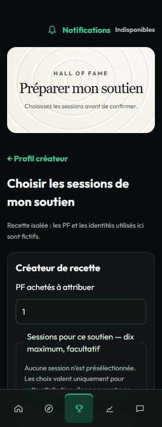

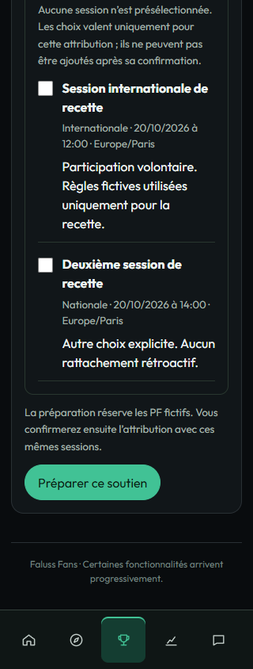

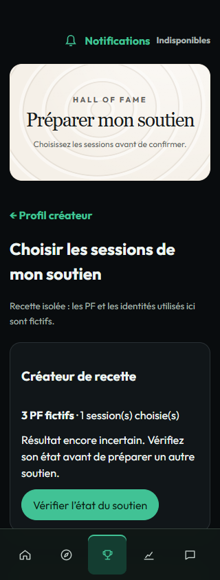

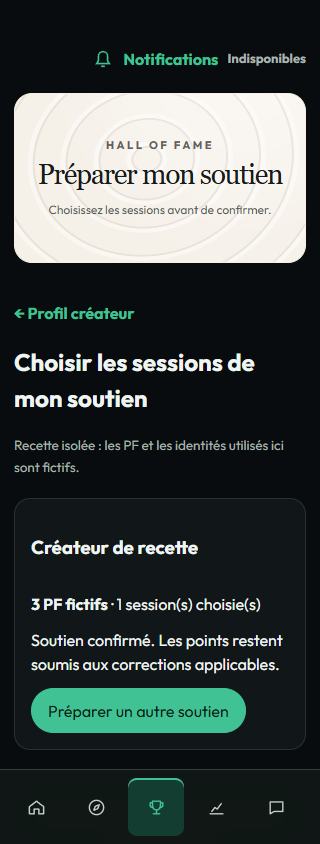

## Frontières

Aucun site, achat réel, admission de pair réel, migration de production ou flag
modifié. Aucun nouveau contrat Hub, aucun ledger PF Fans, aucun indicateur
financier Créateur. La nouvelle direction visuelle HoF reste reportée. La CI et
sa préparation restent inchangées. La publication et l'activation sont des étapes
distinctes ; ces preuves n'ouvrent pas les scores sur les sites.
