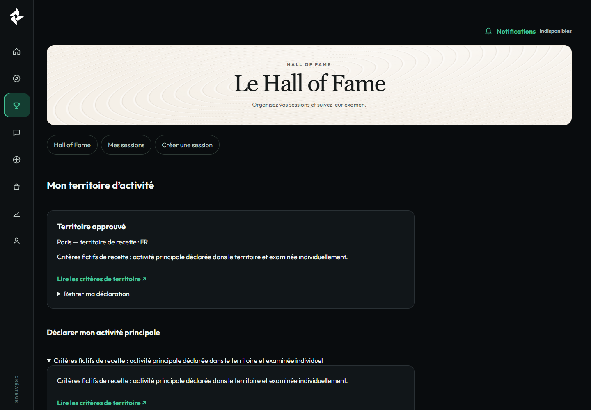
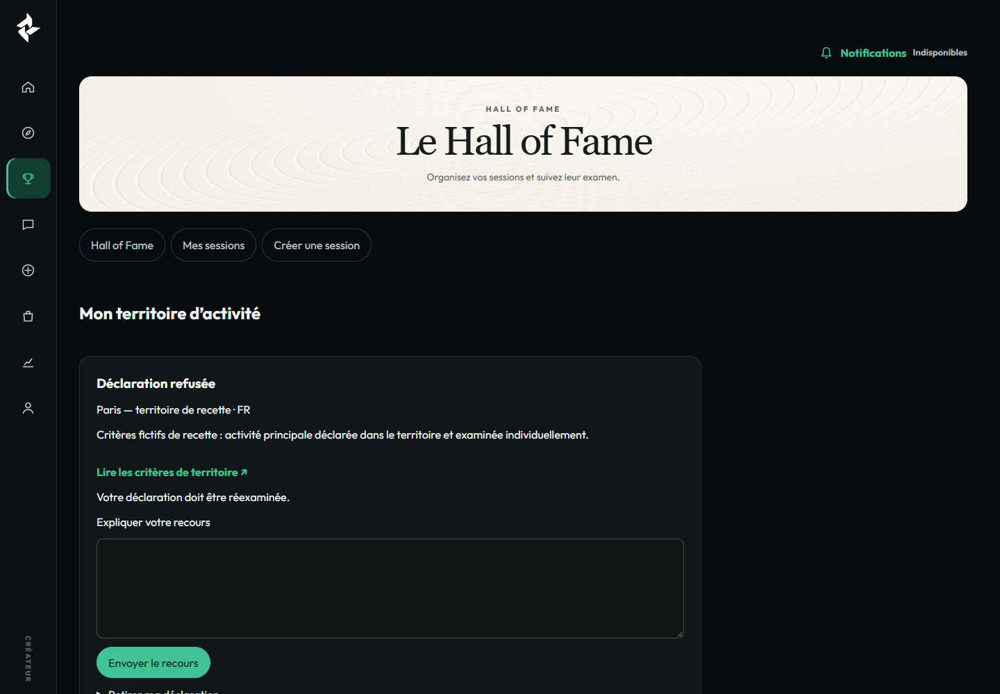
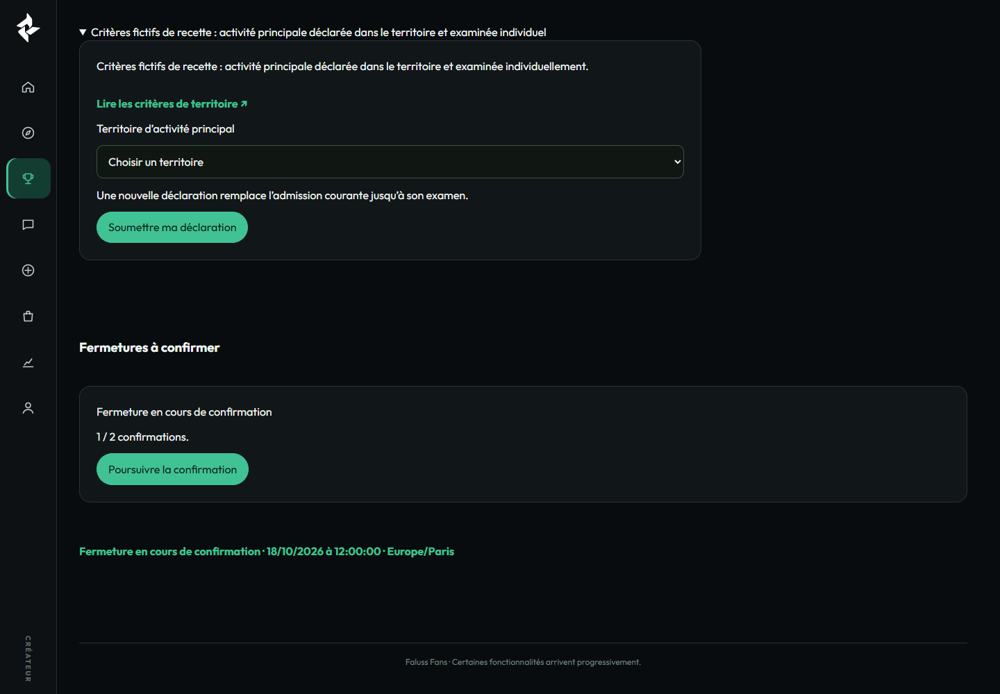
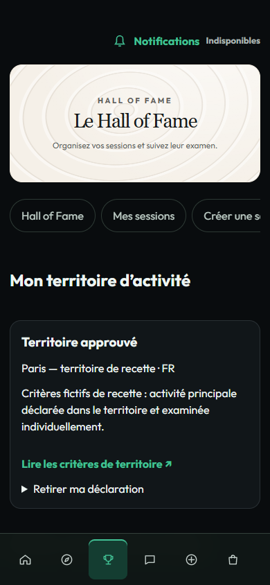
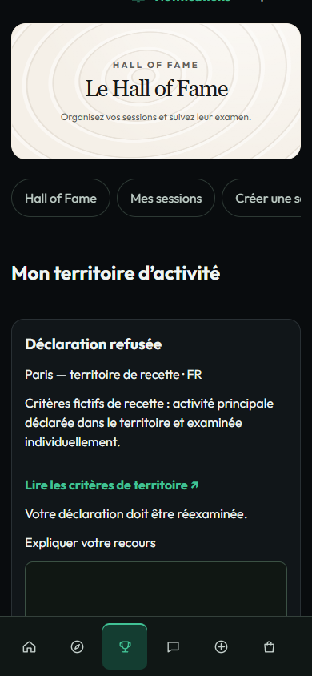
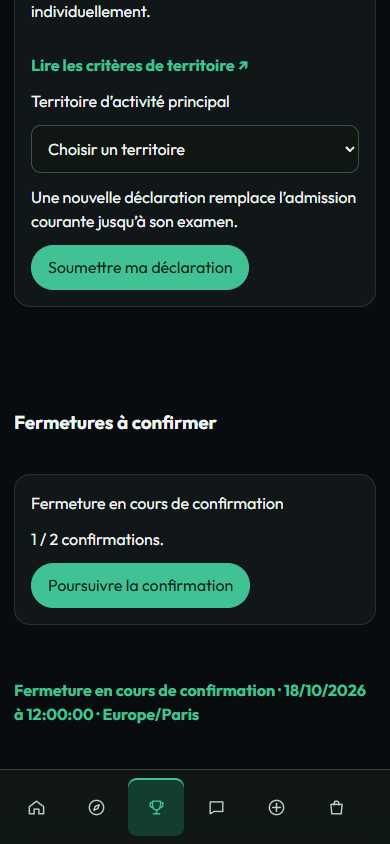
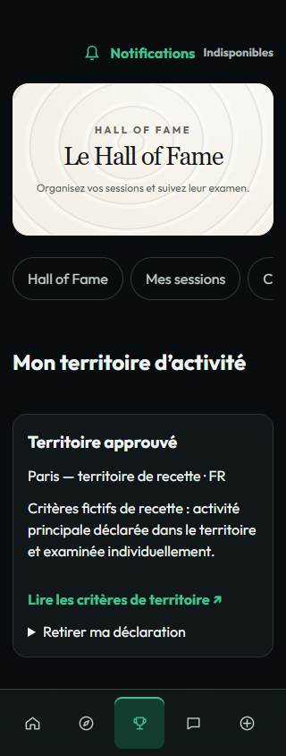
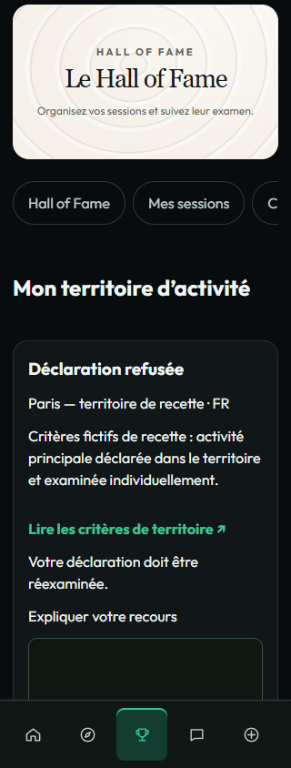
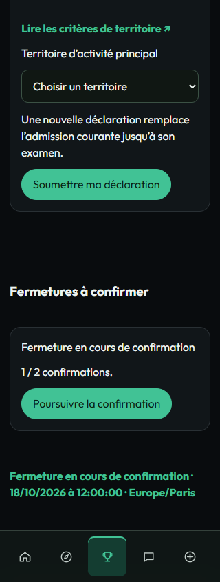

# Territoire natif et reprise — preuves séparées

## Fonctionnement WordPress/MariaDB

Head de code : `d6a111e3b6de22713fcb55a2209dbc43cf984aca`. [PHP quality 39085457052](https://github.com/Alternative-LAB/faluss-platform/actions/runs/39085457052), tous les jobs réussis. Artefact `12121396341` téléchargé et examiné : **913 contrôles, zéro échec**, WordPress 7.1.2, PHP 8.3.35, MariaDB 10.11.14-MariaDB-0ubuntu0.24.04.1. La fixture a été supprimée. Résultats dans [wordpress-ci.json](wordpress-ci.json).

Ces recettes exécutent les services et les formulaires HTTP natifs sur des instances jetables, avec de vrais tokens WordPress locaux, des identités et des preuves fictives. Elles ne prouvent pas le SSO Me, le site cible, le stockage RustFS ou une ouverture économique.

## Rendu navigateur sous Windows

Le redémarrage Ubuntu autorisé n'a pas rétabli ce runtime. Les captures suivantes proviennent donc des **classes de vues PHP exactes du head `3494121aab1b9fec65a4135d0c4cb6e4c8d4e0f4`**, exécutées sous PHP 8.4.24 sur Windows puis affichées dans Chrome headless. Les modèles de vues sont explicitement fictifs et fournis uniquement à un adaptateur externe de lecture. Aucune API ou opération économique n'est simulée pour prétendre un fonctionnement ; celui-ci est prouvé séparément par la recette WordPress ci-dessus.

**Ces captures ne sont ni des pages WordPress actives, ni une recette navigateur du vrai SSO, ni une preuve de rendu sur le site cible.** Aucune décision ou soumission n'est exercée par ce rendu. Les interactions serveur, nonces et décisions concurrentes sont testés en CI ; le navigateur vérifie ici la disposition, le focus, la police, les huit accès et l'absence de débordement/UUID visible. La cloche indisponible et la fermeture des nouveaux envois éventuelle appartiennent à l'adaptateur sans services actifs ; aucun compteur n'est inventé.

Le rapport [browser-replay.json](browser-replay.json) couvre 1 440, 390 et 320 px, sans erreur de page. Le serveur et Chrome temporaires ont été arrêtés après capture. Les captures sont examinées visuellement par l'agent avant revue finale.

## Frontières maintenues

Aucun site consulté, aucune CI ou préparation modifiée, aucun flag de production, migration automatique, pair réel ou paiement. La nouvelle direction visuelle HoF reste reportée. Ces ajouts de preuve ne changent aucun code de production.
